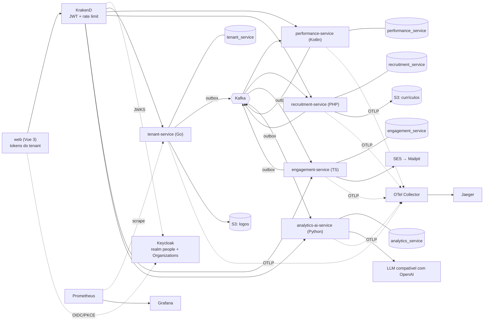

# People Platform


Plataforma de gestão de pessoas (HR tech) **multitenant** e **white label**, construída em **microsserviços poliglotas**: Go, Kotlin, PHP, TypeScript e Python. É um projeto de portfólio com domínio fictício. Os tenants de exemplo, Construtora Horizonte Exemplo e Rede Varejo Sol Exemplo, não existem.

## O problema

Empresas de médio porte gerem pessoas com ferramentas soltas: recrutamento num sistema, avaliação em planilha, clima num formulário genérico, PDI em documento. Os dados não conversam. A avaliação não vira plano de desenvolvimento, quem é contratado não entra numa trilha de integração, e a pesquisa "anônima" de clima não tem garantia real de anonimato, o que derruba a adesão.

A People Platform reúne esses módulos numa plataforma única que cada empresa usa com a **própria marca**, cores, logo, domínio e remetente de e-mail. As garantias de produto são:

- **isolamento entre empresas por construção**, com Row-Level Security no banco e testes de vazamento;
- **acessibilidade garantida no white label**, porque um tema com contraste abaixo de WCAG AA é recusado;
- **anonimato do clima por arquitetura**, não por promessa;
- **IA que sugere e nunca decide**, com toda saída validada por schema.

### Módulos

| Módulo | Escopo | Status |
| --- | --- | --- |
| Tenants e white label | Cadastro, planos e feature flags, tema com WCAG AA, logo, domínio próprio, resolução por host ou claim, `TenantCriado` via outbox | ✅ Implementado |
| Desempenho: nine box, calibração e sucessão | Classificação com limiares por tenant, calibração com trilha de auditoria, histórico e tendência, mapa de sucessão e sugestão de prontidão | 🟡 Núcleo de domínio implementado e testado; API HTTP na próxima rodada |
| Desempenho: ciclos e assessment | Auto, gestor, pares, 180/360 e assessment de competências | 📝 Contrato esboçado |
| Objetivos e metas (OKR) | Desdobramento empresa → colaborador, check-ins | 📋 Planejado |
| PDI | Planos a partir de gaps, ações sugeridas por IA | 📋 Planejado |
| Recrutamento (ATS) | Vagas, pipeline por etapas, entrevistas, scorecards | 📝 Contrato esboçado |
| Engajamento | Feedback, elogios, 1:1, clima anônimo, gamificação, rede social | 📝 Contrato esboçado; ADR de anonimato |
| People analytics | Turnover, tempo de casa, admissões e desligamentos, sempre agregados | 📝 Contrato esboçado |
| Aprendizagem (LXM) | Trilhas e recomendação | 📋 Planejado (só documentado) |
| IA transversal | Feedback, plano de ação do clima, PDI, contexto de 1:1 | 📝 ADR e contrato esboçado |
| Front-end (Vue 3) | White label por tokens | 📋 Planejado |

Legenda: ✅ implementado · 🟡 em andamento · 📝 contrato ou desenho pronto · 📋 planejado.

## Mapa de serviços

| Serviço | Linguagem | Responsabilidade | Status |
| --- | --- | --- | --- |
| [`services/tenant-service`](services/tenant-service) | Go | Tenants, planos e features, white label, domínios, resolução de tenant | ✅ |
| [`services/engagement-service`](services/engagement-service) | TypeScript + NestJS | Feedback, elogios, 1:1, clima anônimo, gamificação, rede social | ✅ |
| [`services/performance-service`](services/performance-service) | Kotlin + Spring Boot | Avaliações, calibração, nine box, sucessão, assessment, OKRs e PDI | 🟡 núcleo de domínio |
| [`services/recruitment-service`](services/recruitment-service) | PHP + Laravel | ATS: vagas, candidaturas, pipeline por tenant, entrevistas, scorecards, `CandidatoContratado` | ✅ |
| `services/engagement-service` | TypeScript + NestJS | Feedback, elogios, 1:1, clima anônimo, gamificação, rede social | 📝 [contrato](contracts/openapi/engagement-service.yaml) |
| `services/analytics-ai-service` | Python + FastAPI | People analytics e recursos de IA | 📝 [contrato](contracts/openapi/analytics-ai-service.yaml) |
| `services/learning-service` | a definir | Aprendizagem (LXM) | 📋 |
| `web/` | Vue 3 | Front-end white label | 📋 |

| Plataforma | Tecnologia |
| --- | --- |
| Identidade | Keycloak 26, realm único com Organizations (um por tenant) |
| Gateway | KrakenD (JWT na borda, rate limit, repasse de host) |
| Eventos | Kafka (KRaft), contratos em AsyncAPI 3.0 e JSON Schema versionado |
| Dados | Postgres, um banco por serviço, RLS por `tenant_id`, transactional outbox |
| AWS (emulada no local) | S3 (logos e currículos) e SES (e-mails white label) no LocalStack; Mailpit para ver os e-mails |
| Observabilidade | OpenTelemetry, Prometheus, Grafana, Jaeger |

## Arquitetura



O desenho completo está no [design doc](docs/design-doc.md): bounded contexts, mapa de contexto, multitenancy por serviço, white label, eventos, outbox, falhas, segurança, LGPD e roadmap.

## Como rodar

Pré-requisitos: Docker com Compose v2, Go 1.26+ e Node 20+ (só para o lint de contratos). Java e Gradle **não** são necessários, porque o performance-service compila e testa na imagem `gradle:8.14.3-jdk21`.

```bash
cp .env.example .env          # opcional: os padrões do compose já funcionam
make up                       # núcleo: Postgres, Kafka, Keycloak, gateway, LocalStack, Mailpit
make tenant-service-up        # build + migração + tenant-service
make engagement-service-up    # build + migração + engagement-service (porta 8082)
make seed                     # os dois tenants fictícios (IDs iguais aos do realm do Keycloak)
make smoke                    # fluxo ponta a ponta pelo gateway com tokens reais
```

Para subir também observabilidade e ferramentas: `make up-all`. Use `make ps` para ver a saúde dos contêineres e `make down` para parar tudo (ou `make clean` para apagar também os volumes).

| Endereço | O quê | Credencial (só dev) |
| --- | --- | --- |
| http://localhost:8000/tenant/v1/plans | Gateway → tenant-service | público |
| http://localhost:8180 | Keycloak (realm `people`) | `admin` / `dev-only-change-me` |
| http://localhost:8025 | Mailpit (e-mails enviados via SES) | — |
| http://localhost:3000 | Grafana (dashboard tenant-service) | `admin` / `dev-only-change-me` |
| http://localhost:16686 | Jaeger | — |
| http://localhost:9090 | Prometheus | — |
| http://localhost:8090 · :8091 | Kafka UI · Adminer (perfil `tools`) | — |

Usuários do realm local, todos com senha `dev-only-change-me`:

- `operador@example.com` (platform-admin);
- `admin@horizonte.example.com` (tenant-admin);
- `colaborador@horizonte.example.com` (employee);
- `admin@sol.example.com` (tenant-admin).

Exemplo manual, com um token do admin da Construtora Horizonte:

```bash
TOKEN=$(curl -s -X POST http://localhost:8180/realms/people/protocol/openid-connect/token \
  -d grant_type=password -d client_id=people-cli \
  -d username=admin@horizonte.example.com -d password=dev-only-change-me | python3 -c 'import json,sys;print(json.load(sys.stdin)["access_token"])')

curl -s http://localhost:8000/tenant/v1/me/tenant -H "Authorization: Bearer $TOKEN"
curl -s http://localhost:8000/tenant/v1/branding -H "X-Forwarded-Host: horizonte.people.localhost"
```

## Como testar

```bash
make lint               # Spectral (contratos) + gofmt/vet + ktlint
make test               # unitários: Go (-short) e Kotlin (JUnit via Docker)
make test-integration   # Go com Postgres real (testcontainers): RLS, outbox, contrato de eventos
```

O que os testes cobrem:

- **tenant-service:**
  - domínio: contraste WCAG com valores de referência e casos de borda (4.48 recusado, 4.54 aceito), planos e overrides, slug e host;
  - casos de uso: autorização por tenant, com 404 para recurso de outro tenant;
  - HTTP: mapeamento de erros e problem+json;
  - JWT: expirado, emissor ou audiência errados, `alg=none`, chave desconhecida;
  - Postgres real: CRUD, outbox atômica, **vazamento entre tenants** (consulta sem WHERE, escrita cruzada, falha fechada, escopo que não sobrevive à transação), relay com falha e com 4 relays concorrentes sem duplicata;
  - **contrato:** o evento publicado é validado contra o JSON Schema do AsyncAPI.
- **performance-service:** classificação nos 9 quadrantes com limiares inclusivos e por tenant, escalas diferentes, política incoerente recusada, calibração (justificativa, limite de faixas contra a posição original, autocalibração, sessão fechada imutável, alerta de topo), histórico e tendência, mapa de sucessão e sugestão de prontidão.

O CI ([`.github/workflows/ci.yml`](.github/workflows/ci.yml)) tem um job por serviço, acionado por filtro de caminhos (`dorny/paths-filter`), mais um job de contratos e um de plataforma (compose, KrakenD, realm, ShellCheck).

## Decisões principais

| ADR | Decisão |
| --- | --- |
| [0001](docs/adr/0001-microsservicos-poliglotas-e-mapa-de-linguagens.md) | Microsserviços poliglotas: cada linguagem onde rende mais, com contratos e convenções comuns |
| [0002](docs/adr/0002-multitenancy-tenant-id-e-rls.md) | Multitenancy pool com `tenant_id` e Row-Level Security, falha fechada e testes de vazamento |
| [0003](docs/adr/0003-white-label-por-design-tokens.md) | White label por design tokens, contraste WCAG AA obrigatório |
| [0004](docs/adr/0004-keycloak-realm-unico-com-organizations.md) | Keycloak com realm único e Organizations, claim `tenant_id` |
| [0005](docs/adr/0005-kafka-asyncapi-e-schemas-versionados.md) | Kafka, AsyncAPI e schemas versionados, chave = `tenant_id` |
| [0006](docs/adr/0006-database-per-service-e-outbox.md) | Database per service e transactional outbox (at-least-once) |
| [0007](docs/adr/0007-anonimato-do-clima-por-desenho.md) | Anonimato do clima por desenho (separação de identidade, k ≥ 5, supressão complementar) |
| [0008](docs/adr/0008-ia-com-validacao-de-schema-e-limites.md) | IA com saída validada por schema, cliente compatível com OpenAI e cliente falso nos testes |
| [0009](docs/adr/0009-api-gateway-krakend.md) | Gateway declarativo com KrakenD |
| [0010](docs/adr/0010-infraestrutura-local-e-servicos-emulados.md) | Compose por perfis, Postgres com banco por serviço, LocalStack (S3, SES) e Mailpit |
| [0011](docs/adr/0011-nucleo-de-dominio-antes-do-framework.md) | Núcleo de domínio do performance-service em Kotlin puro antes do Spring Boot |

Os roteiros de entrevista sobre os núcleos explicam a solução, as alternativas e as perguntas prováveis:

- [isolamento multitenant](docs/roteiros/isolamento-multitenant.md);
- [nine box e calibração](docs/roteiros/nine-box-e-calibracao.md);
- [anonimato do clima](docs/roteiros/anonimato-do-clima.md).

## Trade-offs

- **Poliglota custa caro para operar** (cinco toolchains). Em troca, cada contexto usa a ferramenta certa. Num produto real com time pequeno, eu começaria por um monólito modular (ADR 0001).
- **O modelo pool com RLS** é barato por tenant, mas exige disciplina com o escopo de plataforma e tem o risco de vizinho barulhento. Um silo por tenant fica como opção comercial (ADR 0002).
- **A outbox com polling** acrescenta até 1 s de latência na propagação e exige limpeza periódica. Em troca, não há perda de eventos. Debezium é a evolução natural (ADR 0006).
- **O realm único no Keycloak** simplifica emissor, JWKS e automação, mas compartilha políticas de senha e sessão entre tenants (ADR 0004).
- **O anonimato forte do clima** impede times pequenos de verem o próprio resultado e impede descobrir o autor, inclusive em casos graves, que têm canal próprio (ADR 0007).

## Próximos passos

1. **performance-service:** camada Spring Boot conforme o [OpenAPI](contracts/openapi/performance-service.yaml), persistência com RLS, consumo de `TenantCriado` e publicação de `NineBoxCalibrado`.
2. **Provisionador do Keycloak:** consumir `TenantCriado` e criar a Organization.
3. **engagement-service (NestJS) e analytics-ai-service (FastAPI)** a partir dos contratos esboçados, cada um com RLS, outbox e testes de vazamento.
4. **Fluxo de exclusão de titular (LGPD)** ponta a ponta e limpeza da outbox.
5. **Front-end Vue 3** consumindo `/branding`, com configurador de tema e prévia de contraste.
6. **Kubernetes** (Helm e GitOps), Schema Registry e Debezium.

## Estrutura

```
contracts/          OpenAPI 3.1 (por serviço) e AsyncAPI 3.0 + JSON Schemas dos eventos
docs/               design doc, ADRs e roteiros de entrevista
infra/              Postgres (bancos por serviço), Keycloak, KrakenD, observabilidade, seed
init/aws/           bootstrap do LocalStack (buckets S3 e identidades SES)
scripts/            smoke test ponta a ponta
services/           um diretório por serviço, cada um com Makefile próprio
docker-compose.yml  ambiente local por perfis (core, observability, tools, por serviço)
```

## Licença

[MIT](LICENSE)
