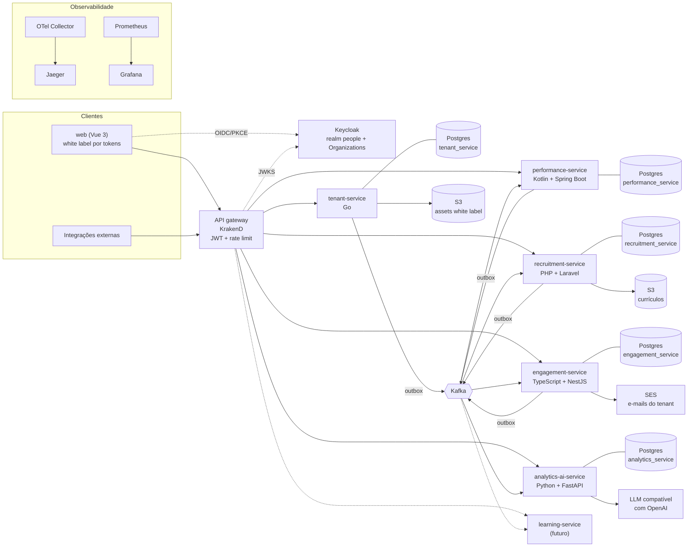
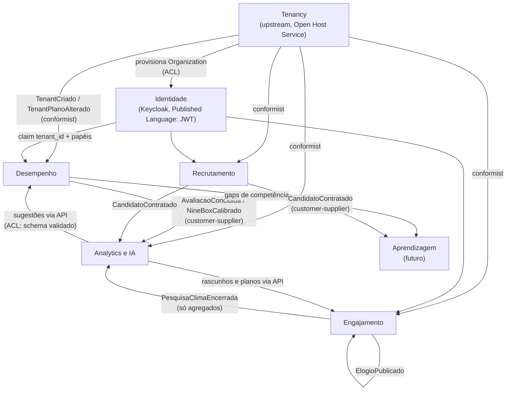
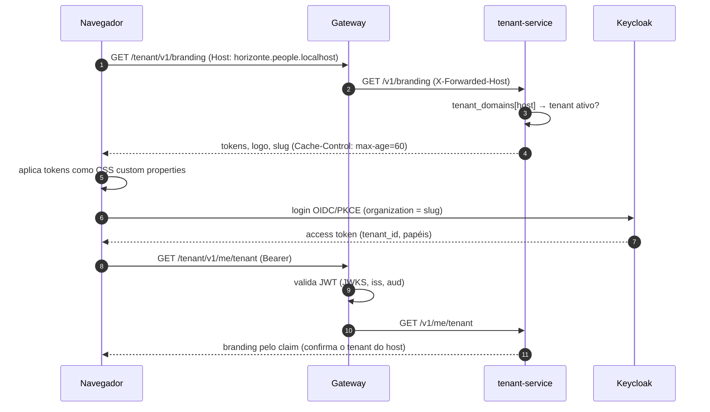
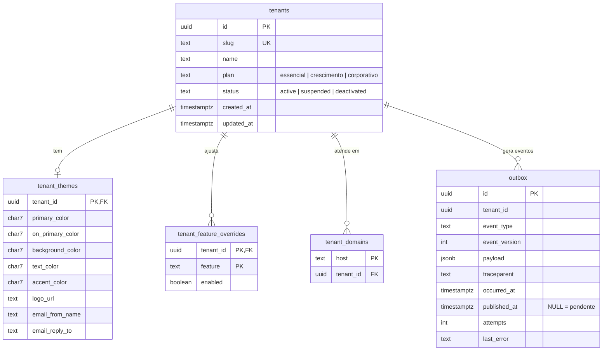
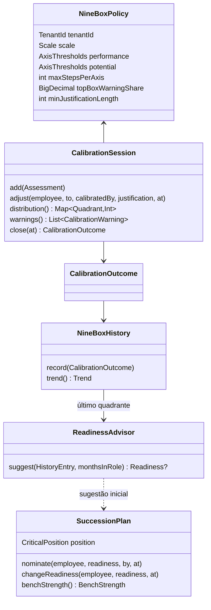
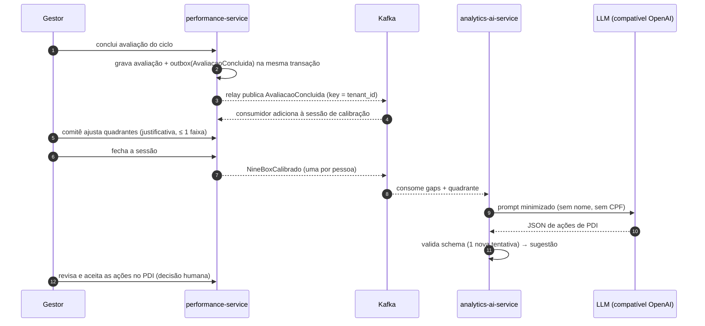

# Design doc: People Platform

- Status: fundação implementada (rodada 1)
- Última revisão: 2026-11-21
- Autor: Johnny Santos
- Domínio: fictício. Os tenants de exemplo (Construtora Horizonte Exemplo, Rede Varejo Sol Exemplo) não existem.

## 1. Contexto

Empresas de médio porte (construtoras, redes de varejo, indústrias) costumam gerir pessoas com uma colcha de retalhos: o recrutamento numa ferramenta, a avaliação de desempenho em planilha, o clima num formulário genérico e o PDI em documento solto. Os dados não conversam. A avaliação não alimenta o plano de desenvolvimento, quem foi contratado não entra automaticamente numa trilha de integração, e a "pesquisa anônima" de clima não tem garantia real de anonimato, o que derruba a adesão.

A **People Platform** é uma plataforma de gestão de pessoas vendida como SaaS. Ela é **multitenant**, com muitas empresas na mesma infraestrutura e isolamento garantido, e **white label**, ou seja, cada empresa vê a plataforma com a própria marca, cores e domínio. A marca da plataforma em si é neutra ("People Platform").

### Módulos do produto

| Módulo | O que resolve |
| --- | --- |
| Recrutamento e seleção (ATS) | Vagas, candidatos, pipeline por etapas, entrevistas e scorecards estruturados |
| Desempenho | Ciclos de avaliação (auto, gestor, pares, 180/360), calibração, nine box, mapa de sucessão e assessment de competências |
| Objetivos e metas | OKRs ou metas tradicionais desdobrados da empresa ao colaborador, com check-ins |
| PDI | Planos de desenvolvimento a partir dos gaps, com IA sugerindo ações |
| Engajamento | Feedback privado, elogios públicos, 1:1 com contexto automático, clima anônimo que vira plano de ação, gamificação e rede social com confirmação de leitura |
| People analytics | Turnover, tempo de casa, admissões e desligamentos cruzados por área, unidade e demografia, sempre agregados |
| Aprendizagem (LXM) | Trilhas customizáveis e recomendação do próximo conteúdo |
| IA transversal | Apoio à redação de feedback, plano de ação do clima, sugestões de PDI e contexto das 1:1 |

## 2. Objetivos e não-objetivos

### Objetivos

1. **Isolamento entre tenants por construção.** Um bug de aplicação não pode expor dados de um tenant a outro, e isso precisa ser verificável por teste automatizado (RLS no Postgres e testes de vazamento).
2. **White label acessível.** Cada tenant aplica a própria marca sem quebrar a acessibilidade, porque contraste abaixo de WCAG AA é recusado.
3. **Contextos desacoplados por eventos.** Avaliação, recrutamento e engajamento se alimentam por eventos com contrato versionado, sem chamadas síncronas em cadeia.
4. **Privacidade por desenho (LGPD).** Minimização, anonimato do clima garantido pela arquitetura e analytics só agregado.
5. **IA segura.** Toda saída de LLM é validada por schema e nunca é aplicada sem confirmação humana.
6. **Operável.** Logs estruturados, métricas RED e traces distribuídos em todos os serviços, desde o primeiro.

### Não-objetivos (por ora)

- Folha de pagamento, ponto eletrônico e benefícios. São outros produtos, que podem ser integrados por API no futuro.
- Multi-região e residência de dados por país.
- Aplicativo mobile nativo. O front-end web será responsivo.
- Customização de layout por tenant além dos design tokens (ADR 0003).
- Billing e cobrança. Plano e features são registrados, mas a cobrança fica fora.

## 3. Arquitetura

### 3.1 Visão geral



O mapa de serviços e linguagens, com a justificativa de cada escolha, está no [ADR 0001](adr/0001-microsservicos-poliglotas-e-mapa-de-linguagens.md).

### 3.2 Bounded contexts e mapa de contexto

| Contexto | Serviço | Responsabilidade | Linguagem ubíqua |
| --- | --- | --- | --- |
| Tenancy | tenant-service | Quem é o cliente, o que ele contratou, como ele se apresenta | tenant, plano, feature, tema, domínio |
| Identidade | Keycloak | Quem é a pessoa e quais papéis ela tem | usuário, organização, papel, token |
| Desempenho | performance-service | Como a pessoa está indo e para onde pode ir | ciclo, avaliação, calibração, quadrante, prontidão, OKR, PDI |
| Recrutamento | recruitment-service | Como a pessoa chega | vaga, candidatura, etapa, scorecard |
| Engajamento | engagement-service | Como a pessoa se sente e se relaciona | feedback, elogio, 1:1, pesquisa, segmento, pontos |
| Analytics e IA | analytics-ai-service | O que os dados agregados dizem e sugestões assistidas | indicador, coorte, sugestão, rascunho |
| Aprendizagem | learning-service (futuro) | Como a pessoa se desenvolve | trilha, conteúdo, progresso |



Relações principais:

- **Tenancy é upstream de todos.** Os outros contextos se conformam ao modelo de tenant e plano (*conformist*) e mantêm uma projeção local mínima: `tenant_id`, status e features.
- **Identidade é uma Published Language.** O contrato é o JWT, com `tenant_id` e `realm_access.roles`. Nenhum serviço consulta o Keycloak por usuário em tempo de requisição.
- **Desempenho → Analytics/IA e Aprendizagem** é *customer-supplier*. Desempenho publica os fatos (avaliação concluída, quadrante final), e os consumidores derivam indicadores e trilhas.
- **Analytics/IA → Desempenho e Engajamento** passa por uma *anticorruption layer*. A IA devolve estruturas validadas por schema, e o contexto que recebe decide o que aceitar (ADR 0008).

### 3.3 Mapa de serviços

| Serviço | Linguagem | Responsabilidade | Status |
| --- | --- | --- | --- |
| tenant-service | Go | Tenants, planos e features, white label, domínios, resolução de tenant, `TenantCriado` | Implementado |
| performance-service | Kotlin + Spring Boot | Avaliações, calibração, nine box, sucessão, assessment, OKRs, PDI | Núcleo de domínio (nine box, calibração, histórico, sucessão) |
| recruitment-service | PHP + Laravel | ATS | Implementado |
| engagement-service | TypeScript + NestJS | Feedback, elogios, 1:1, clima, gamificação, rede social | Contrato esboçado |
| analytics-ai-service | Python + FastAPI | People analytics e IA | Contrato esboçado |
| learning-service | a definir | LXM | Documentado |
| web | Vue 3 | Front-end white label | Planejado |

### 3.4 Arquitetura interna dos serviços

Todos os serviços seguem arquitetura **hexagonal**: o domínio não conhece banco, HTTP nem Kafka. No tenant-service, isso fica assim:

```
cmd/tenant-service      composição: config, pools, adaptadores
internal/domain         Tenant, Plan/Feature, Theme (WCAG), eventos (sem dependências externas)
internal/app            casos de uso, autorização e portas (Repository, AssetStorage)
internal/adapters/...   postgres (RLS + outbox), httpapi, kafka, s3, memory
internal/platform/...   auth (JWT/JWKS), config, telemetria
```

No performance-service, o núcleo `com.peopleplatform.performance.domain` é Kotlin puro. A camada Spring Boot entra como adaptadores na próxima rodada ([ADR 0011](adr/0011-nucleo-de-dominio-antes-do-framework.md)).

## 4. Multitenancy

A decisão completa está no [ADR 0002](adr/0002-multitenancy-tenant-id-e-rls.md). Em resumo:

- **Modelo pool:** cada serviço tem um banco, e os tenants compartilham as tabelas, com `tenant_id NOT NULL` em todas.
- **De onde vem o tenant:** sempre da claim `tenant_id` do token validado, nunca do corpo ou da query da requisição. A única exceção é a resolução por host (pré-login), que só devolve dados públicos de marca.
- **Row-Level Security:** `ENABLE` + `FORCE ROW LEVEL SECURITY` com políticas `USING` e `WITH CHECK` sobre `tenant_id = app_current_tenant()`. O usuário de conexão da aplicação não é dono das tabelas e não tem `BYPASSRLS`. O escopo é definido por transação com `set_config('app.tenant_id', $1, true)`.
- **Falha fechada:** sem escopo, nenhuma linha é visível.
- **Escopo de plataforma:** `app.platform = on`, usado só em listar tenants, resolver host e no relay da outbox.
- **Eventos:** `tenant_id` obrigatório no envelope e como chave da mensagem Kafka. Consumidores gravam o efeito no escopo do `tenant_id` do evento.
- **Objetos no S3:** a chave começa com `tenants/{tenant_id}/`, e as URLs pré-assinadas são geradas para uma chave exata.
- **Testes de vazamento** (implementados no tenant-service, obrigatórios em todo serviço com persistência):

| Teste | O que prova |
| --- | --- |
| Consulta sem WHERE no escopo de A | RLS filtra mesmo quando a aplicação esquece o filtro |
| INSERT com `tenant_id` de B no escopo de A | `WITH CHECK` bloqueia escrita cruzada |
| UPDATE em linha de B no escopo de A | Afeta 0 linhas |
| Consulta sem escopo | Falha fechada: 0 linhas |
| Escopo após o fim da transação | `SET LOCAL` não vaza pelo pool de conexões |
| Admin de A pede recurso de B pela API | 404, sem revelar que o recurso existe |

| Serviço | Estratégia por serviço |
| --- | --- |
| tenant-service | RLS em todas as tabelas; a própria tabela `tenants` filtra por `id` |
| performance-service | RLS; o domínio também recusa operações entre tenants (`requireSameTenant`) |
| recruitment-service | RLS; currículos no bucket privado com prefixo por tenant e expiração |
| engagement-service | RLS; respostas de clima em tabela sem identidade (ADR 0007) |
| analytics-ai-service | Tabelas analíticas com `tenant_id` e RLS; consultas só devolvem agregados com k mínimo |

## 5. White label

A decisão está no [ADR 0003](adr/0003-white-label-por-design-tokens.md).

- **Tokens semânticos:** `color.primary`, `color.on-primary`, `color.background`, `color.text` e `color.accent`, mais logo e remetente de e-mail.
- **Contraste WCAG AA (4.5:1)** é verificado nos pares `on_primary/primary`, `text/background` e `accent/background`. A luminância relativa segue a fórmula do WCAG, e a comparação é feita sem arredondamento. O HTTP 422 informa par, razão obtida e mínimo.
- **Resolução de tenant:**



- **Logo:** `POST /theme/logo-upload` devolve uma URL pré-assinada (PUT, Content-Type fixo, 10 min) para `tenants/{id}/logo/{uuid}.{ext}`. O navegador envia direto ao S3 (LocalStack no ambiente local) e grava `public_url` no tema.
- **E-mails:** saem via SES com `From: "<email_from_name>" <no-reply@...>` e `Reply-To` do tenant. Localmente, o SES do LocalStack entrega no Mailpit.
- **Domínio próprio:** é feature de plano (`custom_domain`), e o host é único na plataforma. Em produção, um certificado por domínio seria emitido por ACME no edge, o que fica fora do escopo desta rodada.

## 6. Modelo de dados

### 6.1 tenant-service (implementado)



O catálogo de planos vive no código (`domain.Catalog`), não em tabela, porque muda junto com o produto e precisa de revisão em PR. Features efetivas = pacote do plano + overrides permitidos pelo plano. Depois de um downgrade, overrides que deixaram de ser permitidos são ignorados, em vez de vazarem acesso.

### 6.2 performance-service (núcleo de domínio implementado; persistência na próxima rodada)



Tabelas previstas, todas com `tenant_id` e RLS: `nine_box_policies`, `review_cycles`, `assessments`, `calibration_sessions`, `calibration_adjustments` (append-only, trilha de auditoria), `nine_box_history`, `critical_positions`, `successors`, `objectives`, `key_results`, `check_ins`, `development_plans`, `development_actions`, `processed_events` e `outbox`.

### 6.3 Demais serviços (previsto)

- **recruitment-service:** `jobs`, `pipeline_stages`, `candidates`, `applications`, `interviews`, `scorecards`. O currículo fica só no S3, e o banco guarda a chave.
- **engagement-service:** `feedbacks` (visíveis só às duas partes), `praises`, `one_on_ones`, `surveys`, `survey_participation`, `survey_response` (sem identidade, ADR 0007), `points_ledger`, `badges`, `posts` e `read_receipts`.
- **analytics-ai-service:** fatos agregados por tenant, período e segmento (`headcount_facts`, `turnover_facts`), mais `ai_generations` (metadados sem conteúdo).

## 7. Eventos de domínio entre contextos

Os contratos estão em [`contracts/asyncapi/people-platform.yaml`](../contracts/asyncapi/people-platform.yaml) e os schemas em `contracts/asyncapi/schemas/*.v1.json`. As regras estão no [ADR 0005](adr/0005-kafka-asyncapi-e-schemas-versionados.md).

| Evento | Produtor | Consumidores | Efeito |
| --- | --- | --- | --- |
| `TenantCriado` | tenant-service | todos, mais o provisionador do Keycloak | Cria a projeção do tenant e a Organization |
| `TenantPlanoAlterado` | tenant-service | todos | Liga ou desliga módulos conforme as features |
| `AvaliacaoConcluida` | performance-service | performance (calibração), analytics-ai (gaps → PDI) | Entra na sessão de calibração; gaps viram sugestões de PDI |
| `NineBoxCalibrado` | performance-service | performance (PDI, sucessão), analytics-ai | Histórico; sugestão de prontidão; indicadores agregados |
| `CandidatoContratado` | recruitment-service | learning (onboarding), analytics-ai (admissões) | Trilha de integração; indicador de admissões |
| `ElogioPublicado` | engagement-service | engagement (gamificação, contexto de 1:1) | Pontos e badges |
| `PesquisaClimaEncerrada` | engagement-service | analytics-ai | Proposta de plano de ação a partir de agregados com k mínimo |

Fluxo de ponta a ponta, da avaliação ao PDI:



Fluxo da criação de tenant, que é o que está implementado:

```mermaid
sequenceDiagram
    autonumber
    participant O as Operador
    participant GW as Gateway
    participant T as tenant-service
    participant DB as Postgres (RLS)
    participant R as Relay da outbox
    participant K as Kafka

    O->>GW: POST /tenant/v1/tenants (Bearer, platform-admin)
    GW->>T: valida JWT de novo e checa o papel
    T->>DB: BEGIN; SET LOCAL app.tenant_id = novo id
    T->>DB: INSERT tenants + INSERT outbox(TenantCriado, traceparent)
    T->>DB: COMMIT
    T-->>O: 201 Created
    loop a cada 1 s (ou já, se o lote anterior veio cheio)
        R->>DB: SELECT ... FOR UPDATE SKIP LOCKED (escopo de plataforma)
        R->>K: produce (acks=all, key=tenant_id, header traceparent)
        R->>DB: UPDATE published_at = now()
    end
```

## 8. Consistência eventual e outbox

A decisão está no [ADR 0006](adr/0006-database-per-service-e-outbox.md).

- **Outbox transacional** em todo serviço produtor. O relay usa `SKIP LOCKED`, o que permite várias réplicas, e cada falha incrementa `attempts` e registra `last_error`.
- **At-least-once** ponta a ponta. Cada consumidor grava `processed_events(event_id)` na mesma transação do efeito, então um evento repetido é ignorado.
- **Ordem por tenant** pela chave da partição. Entre tenants não há ordem, e nenhuma regra depende disso.
- **Janelas de inconsistência aceitas** (exemplos):
  - tenant recém-criado ainda sem Organization no Keycloak, por alguns segundos. A UI de onboarding mostra "provisionando";
  - mudança de plano propagada aos serviços com atraso de segundos. Até lá vale a projeção anterior, e o tenant-service continua sendo a fonte da verdade para decisões comerciais.
- **Reprocessamento:** consumidores aceitam replay desde um offset. Projeções são reconstruíveis a partir do tópico, com retenção longa nos tópicos de domínio.

## 9. Falhas e como são tratadas

| Falha | Comportamento | Onde está |
| --- | --- | --- |
| Kafka indisponível | Escritas continuam; eventos acumulam na outbox; relay retenta; `outbox_publish_failures_total` sobe; `/readyz` reporta indisponível | `outbox.go`, alerta `OutboxPublishFailing` |
| Publicação ok, commit da marcação falha | Evento republicado; consumidores deduplicam por `event_id` | ADR 0006 |
| Dois relays ao mesmo tempo | `FOR UPDATE SKIP LOCKED`; teste com 4 relays concorrentes sem duplicata | `outbox_test.go` |
| Postgres indisponível | `/readyz` 503; requisições falham com 500 sem detalhe; log com `trace_id` | `server.go` |
| Keycloak indisponível | Tokens já emitidos continuam válidos (JWKS em cache); chave desconhecida rebusca no máximo a cada 30 s | `auth/jwt.go` |
| Token forjado, expirado ou de outro emissor | 401 no gateway e no serviço (defesa em profundidade); `alg=none` recusado | `auth/jwt_test.go` |
| Requisição para recurso de outro tenant | 404 (não 403); RLS impede leitura mesmo com bug | `service.go`, testes de RLS |
| Corpo enorme ou com campos desconhecidos | Limite de 64 KB; `DisallowUnknownFields` → 400 | `server.go` |
| Tema com contraste insuficiente | 422 com o par e a razão | `theme.go` |
| Tema corrompido manualmente no banco | Revalidado na leitura; erro explícito em vez de servir tema inválido | `repository.go` |
| Downgrade de plano | Overrides não permitidos são ignorados no cálculo das features | `plan.go` |
| Saída de LLM inválida | 1 nova tentativa com o erro de validação; depois, `422 ai_output_invalid` sem gravar nada | ADR 0008 |
| Ajuste de calibração fora da regra | `DomainException` (sem justificativa, salto maior que o permitido, autocalibração, sessão fechada) | `Calibration.kt` |
| Desligamento do processo | `SIGTERM` → shutdown gracioso (10 s), relay encerra com o contexto | `main.go` |

## 10. Segurança e LGPD

### 10.1 Segurança

- **Autenticação:** OIDC no Keycloak (realm único com Organizations, [ADR 0004](adr/0004-keycloak-realm-unico-com-organizations.md)). O front-end usa PKCE. O client de password grant existe só no ambiente local.
- **Autorização:**
  - os papéis (`platform-admin`, `tenant-admin`, `manager`, `employee`) vêm do token;
  - as regras ficam nos casos de uso (`Principal.CanRead` / `CanManage`), não nos handlers;
  - ligar uma feature adicional é decisão comercial, então só o operador pode. O admin do tenant só desliga.
- **Defesa em profundidade:** gateway e serviço validam o JWT, e o RLS no banco cobre bugs de autorização na aplicação.
- **Entrada:** JSON estrito, limite de tamanho, validação no domínio e erros RFC 9457 sem stack trace.
- **Segredos:** nenhum segredo versionado. `.env` fica no `.gitignore`, e o `.env.example` traz só valores `dev-only-change-me`. Em produção, os segredos viriam de um secret manager (fora do escopo desta rodada).
- **Contêineres:** imagem distroless, usuário `nonroot` e binário estático.
- **Uploads:** URL pré-assinada com Content-Type fixo, chave por tenant e expiração curta. O serviço nunca recebe o binário.

### 10.2 LGPD

| Tema | Como a plataforma trata |
| --- | --- |
| Papéis | O tenant (empregador) é o **controlador**; a plataforma é **operadora** e trata dados conforme instrução do tenant (contrato de operação). |
| Base legal | Execução de contrato de trabalho e obrigação legal para dados de vínculo; legítimo interesse documentado (com teste de balanceamento) para desempenho e desenvolvimento; consentimento para participação voluntária em pesquisas e rede social; para candidatos, procedimentos preliminares a contrato. |
| Minimização | Eventos carregam IDs, não dados de contato (ex.: `CandidatoContratado` não leva currículo nem telefone); prompts de IA sem identificadores diretos; analytics só agregado com k mínimo. |
| Anonimato do clima | Por arquitetura, não por promessa ([ADR 0007](adr/0007-anonimato-do-clima-por-desenho.md)): identidade e resposta em tabelas sem ligação, segmento grosso, k ≥ 5 (mínimo absoluto 3), supressão complementar. |
| Dados sensíveis | Dados demográficos usados em analytics (ex.: gênero, faixa etária) são opcionais, coletados com consentimento específico e só aparecem agregados. |
| Retenção | Currículos de não contratados expiram (lifecycle de 365 dias no bucket); outbox publicada é limpa periodicamente (planejado); dados de vínculo seguem prazos legais trabalhistas. |
| Direito de exclusão e acesso | Um evento `TitularExclusaoSolicitada` (planejado) dispara, em cada serviço, anonimização dos registros do titular (substituição do `employee_id` por um identificador irreversível e remoção de texto livre), preservando agregados e obrigações legais; cada serviço responde com `TitularExclusaoConcluida`, e o tenant-service consolida o relatório para o controlador. Exportação (portabilidade) segue o mesmo fluxo. |
| Encerramento do tenant | `DELETE /tenants/{id}` desativa (não apaga) porque o controlador precisa de prazo para exportar; a exclusão física por tenant é um job que percorre os serviços por `tenant_id`, viável justamente pelo modelo pool com `tenant_id` em toda tabela. |
| Logs e traces | Sem dados pessoais em logs; o collector remove `authorization` e `enduser.email` de spans por garantia. |

## 11. Observabilidade

| Sinal | Como | Onde ver |
| --- | --- | --- |
| Logs | JSON em stdout (`slog`), com `service`, `trace_id` e `span_id`; log de acesso por rota (sem `/metrics` e health) | `make logs S=tenant-service` |
| Métricas | Prometheus em `/metrics`: `http_requests_total{route,method,status}`, `http_request_duration_seconds`, `outbox_events_published_total`, `outbox_publish_failures_total`, runtime Go; a rota usa o padrão do roteador (não a URL crua) para limitar cardinalidade | Prometheus `:9090`, dashboard "tenant-service (RED + outbox)" no Grafana `:3000` |
| Traces | OpenTelemetry (OTLP/HTTP) → Collector → Jaeger; `otelhttp` no servidor; `traceparent` gravado na outbox e propagado no header Kafka, ligando o request ao consumo do evento | Jaeger `:16686` |
| Alertas | `OutboxPublishFailing` (falhas contínuas no relay) e `HighErrorRate` (> 5 % de 5xx por 10 min) | `infra/observability/alerts.yml` |
| Saúde | `/healthz` (liveness), `/readyz` (Postgres e Kafka) | healthcheck do compose |

Os SLOs iniciais propostos para o tenant-service, por estar no caminho de toda requisição, são disponibilidade de 99,9 % em `/v1/branding` e `/v1/me/tenant` e p95 abaixo de 100 ms.

## 12. Alternativas consideradas

| Tema | Alternativa | Por que não (agora) |
| --- | --- | --- |
| Arquitetura | Monólito modular | Seria a escolha para um time pequeno num produto real; aqui o objetivo inclui integração por eventos e operação poliglota (ADR 0001) |
| Multitenancy | Banco ou schema por tenant | Custo e migrações lineares no número de tenants; silo fica como opção para clientes grandes (ADR 0002) |
| Identidade | Realm por tenant | Um emissor/JWKS por tenant e milhares de realms (ADR 0004) |
| Mensageria | RabbitMQ | Sem replay e retenção longa, essenciais para analytics (ADR 0005) |
| Publicação de eventos | CDC com Debezium | Mais infraestrutura; a outbox já é compatível com o router do Debezium (ADR 0006) |
| Anonimato | Pseudonimização | Reversível por força bruta num universo pequeno (ADR 0007) |
| Gateway | Kong, Envoy | Mais pesados ou de baixo nível para o estágio atual (ADR 0009) |
| Object storage local | MinIO | LocalStack cobre S3 e SES numa imagem só (ADR 0010) |

## 13. Plano de evolução e roadmap por módulo

| Módulo / item | Rodada 1 (fundação) | Rodada 2 | Rodada 3+ |
| --- | --- | --- | --- |
| Tenants e white label | **Implementado**: CRUD, planos, features, tema WCAG, domínios, resolução, outbox, RLS, OTel | Provisionador de Organization no Keycloak a partir de `TenantCriado`; limpeza da outbox | Domínio próprio com certificado ACME; silo opcional por tenant |
| Desempenho: nine box, calibração e sucessão | **Núcleo de domínio implementado e testado** | API Spring Boot conforme OpenAPI, persistência com RLS, outbox `NineBoxCalibrado` | Assessment de competências |
| Desempenho: ciclos de avaliação | Contrato esboçado | Ciclos auto/gestor/pares, consolidação, `AvaliacaoConcluida` | 180/360 com anonimato de pares |
| Objetivos e metas | Documentado | — | OKRs desdobrados com check-ins |
| PDI | Documentado | Consumo de gaps | Sugestões por IA e acompanhamento |
| Recrutamento (ATS) | Contrato esboçado | Laravel: vagas, pipeline, currículos no S3, `CandidatoContratado` | Scorecards e entrevistas |
| Engajamento | Contrato esboçado; ADR de anonimato | NestJS: feedback, elogios, clima com k-anonimato | 1:1 com contexto, gamificação, rede social |
| People analytics e IA | Contrato esboçado; ADR de IA | FastAPI: turnover agregado, cliente LLM falso nos testes | Plano de ação do clima, rascunho de feedback |
| Aprendizagem (LXM) | Documentado | — | Trilhas e recomendação |
| Front-end white label | Tokens servidos pela API | Vue 3 consumindo `/branding` | Configurador de tema com prévia de contraste |
| Plataforma | Compose por perfis, KrakenD, Keycloak, Kafka, observabilidade, CI por caminho | Exclusão de titular (LGPD) ponta a ponta | Kubernetes (Helm/GitOps), Schema Registry, Debezium |

## 14. Questões em aberto

- Quando adotar Schema Registry: no segundo consumidor real de um evento ou já na rodada 2?
- Como dividir o performance-service se OKR e PDI crescerem a ponto de justificar serviços próprios? O critério proposto é ciclo de vida e time diferentes.
- O valor padrão de k para o clima (5) precisa ser validado com o RH dos tenants piloto.
